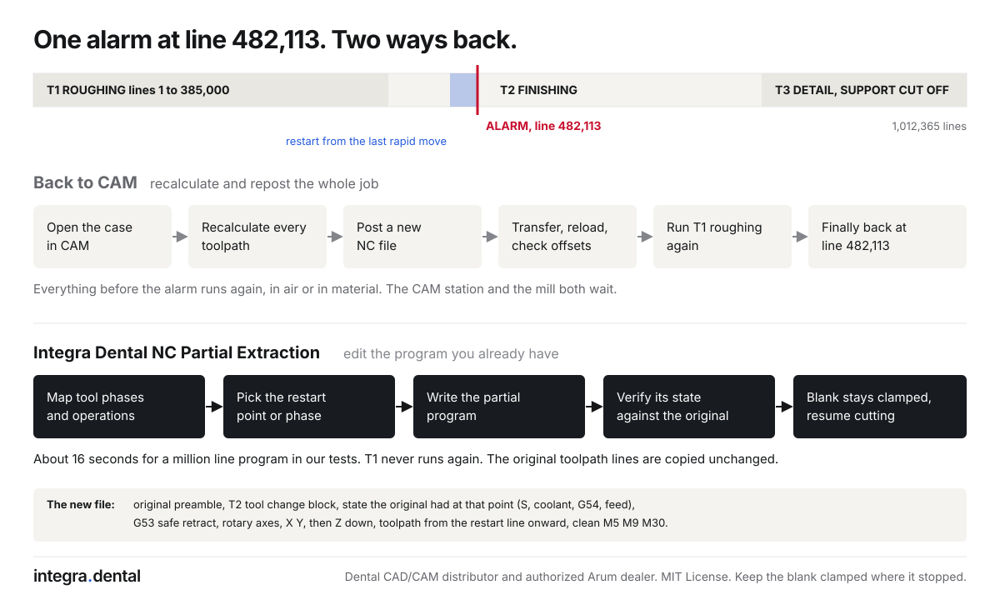

# Integra Dental NC Partial Extraction

**Restart the cut, not the whole job.**

Restart a long milling job in the middle, run one tool or one operation on its own, or cut a line range out of a big NC program, without going back to CAM and without hand editing a million lines of G-code.

This is a free, open source Claude skill and Claude Code plugin, plus a small command line tool. It reads a Fanuc style NC program, maps it into tool phases and operations, and writes a new program that keeps the original preamble and tool change, restores the machine state the original had at that point, retracts and approaches safely, and ends cleanly. Before it saves anything, it simulates the new program and checks that its state matches the original.

Made by [Integra Dental](https://integra.dental), a dental CAD/CAM distributor and authorized Arum dealer with its own lab and milling center in Bellevue, Washington. We install, train on and run these machines every day, and we built this for the stops we see at our own mills and at the labs we support.



Visual guide: [`docs/index.html`](docs/index.html) (also published with GitHub Pages when enabled).

## The problem it solves

A mill stops halfway through a long zirconia job: an air pressure alarm, a broken tool, a power cut. The usual fix is to open the case in CAM again, recalculate every toolpath, post a new file, reload it and run roughing again until the machine is back where it stopped. Everything before the alarm runs again, and both the CAM station and the mill wait.

The toolpath you need is already in the NC file you have. This tool edits that file instead of rebuilding it: it keeps the lines from the restart point onward exactly as CAM wrote them and adds only what is needed to start there safely.

## Who it is for

* Dental labs and milling centers running 5 axis wet or dry mills with CAM generated G-code.
* CAM operators who need to restart a zirconia or PMMA job after a stop without rerunning roughing.
* Anyone who needs one phase on its own, for example only the final support cut off pass so the parts drop, or rerunning a single finishing tool.
* Anyone trying to work out why a program will not load on the control.

## What it does

* **check**: finds structural problems that stop files loading: missing M30, code after the end, byte order marks, non ASCII characters in comments, unbalanced parentheses, mixed line endings, axis values without decimal points.
* **map**: lists every tool phase with its line range, tool, spindle speed, length offset, operations (taken from the CAM comments), an estimate of cutting time, and how many safe restart points it has.
* **find**: finds a block number (N1234), any text, or the lines closest to a position the control showed when it stopped.
* **extract**: writes one phase, a range of phases, one operation, or a line range as its own program.
* **restart**: writes a program that starts at a chosen line or block number and runs to the end (or to the end of the phase or operation).

Every program it writes:

1. keeps the original preamble (program number, units, plane, any machine specific setup);
2. keeps the phase's own tool change block unchanged;
3. adds back anything the original had set earlier that this phase relies on (work offset, spindle speed changed mid phase, coolant left on from an earlier tool, feed, motion mode);
4. for restarts, retracts to the program's own safe Z in machine coordinates, turns the rotary axes at that height, positions X and Y, then comes down in Z;
5. copies the original toolpath lines byte for byte;
6. ends with a retract, M5, M9 and M30 when the selection does not already include the program end;
7. keeps the original line endings (CRLF or LF).

Restarts in the middle of a toolpath move back to the last rapid move before the line you asked for, so the tool comes in the way the CAM planned and repeats a little path in air. You can choose the start of the operation instead, the start of the phase, or the exact line with a slow plunge.

It refuses, and explains why, when a restart would not be safe to compute: inside G91 incremental sections, inside canned drilling cycles, with cutter compensation on, or with coordinate rotation, scaling, G52 or G92 active.

## Install

You need Python 3.8 or newer. There are no other dependencies.

### Claude Code (plugin)

```
/plugin marketplace add pman7/integra-dental-nc-partial-extraction
/plugin install integra-dental-nc-partial-extraction@integra-dental
```

On Claude Code 2.1.275 or later this also works in one step:

```
/plugin install integra-dental-nc-partial-extraction --marketplace pman7/integra-dental-nc-partial-extraction
```

Then ask Claude something like "restart this program from block N48210" or "give me just the T3 support cut off pass from this file".

### Claude apps (skill upload)

Zip the `skills/integra-dental-nc-partial-extraction` folder and upload the zip as a skill in Claude's settings (Capabilities, Skills). Code execution must be turned on.

You can also copy that folder into `~/.claude/skills/` (for you) or `.claude/skills/` in a project (for your team).

Claude will map the file, ask what you need, run the script, explain the result and walk you through the prove out.

### Command line

```
python3 skills/integra-dental-nc-partial-extraction/scripts/nc_extract.py --help
```

## Examples

The `examples` folder has a synthetic three tool program (`sample_crown.nc`) and outputs made from it. It is made up and contains no real case or patient data. The commands below use `nc_extract.py` as short for `skills/integra-dental-nc-partial-extraction/scripts/nc_extract.py`.

Map a program:

```
$ python3 nc_extract.py map examples/sample_crown.nc
sample_crown.nc: 638 lines, LF line endings
Preamble: lines 1 to 6
Safe retract found: G53 G0 Z0.

Phase 1  T1  lines 7 to 202  (tool change block to line 15)
  S18000, H1, about 1.2 min of cutting feed, 14 restart points
  T1 FLAT END MILL D2.5 ROUGHING
    op 1  lines 16 to 107  ROUGHING FRONT
    op 2  lines 108 to 202  ROUGHING BACK

Phase 2  T2  lines 203 to 442  (tool change block to line 210)
  S24000, H2, about 1.2 min of cutting feed, 13 restart points
  T2 BALL END MILL D1.0 FINISHING
    op 1  lines 211 to 244  FINISH OCCLUSAL
    op 2  lines 245 to 442  FINISH MARGIN

Phase 3  T3  lines 443 to 638  (tool change block to line 449)
  S28000, H3, about 0.6 min of cutting feed, 14 restart points
  T3 BALL END MILL D0.6 DETAIL AND SUPPORT CUT OFF
    op 1  lines 450 to 618  DETAIL FISSURES
    op 2  lines 619 to 638  SUPPORT CUT OFF
```

Restart after a stop at line 300, skipping T1 entirely:

```
$ python3 nc_extract.py restart examples/sample_crown.nc --line 300
Wrote examples/sample_crown_R300.nc (419 lines)
  phase 2, tool T2, mode rapid, source lines 249 to 638
  later tool changes kept: T3
  verification: passed
  note: Moved the start back from line 300 to line 248, the last rapid move before it.
```

The start of that file looks like this:

```
%
O1001
(PARTIAL PROGRAM BY INTEGRA DENTAL NC EXTRACTION V0.1.0)
(SOURCE SAMPLE_CROWN.NC)
(KEEPS SOURCE LINES 249 TO 638 PHASE 2 T2)
(ENTRY RESTART AT RAPID LINE 248)
(PROVE OUT WITH AN AIR CUT BEFORE CUTTING)
...
G90 G17 G21 G40 G80 G94
G53 G0 Z0.
(RESTORE MODAL STATE)
G54
(T2 BALL END MILL D1.0 FINISHING)
T2 M6
T3
S24000 M3
M8
G0 A0. B0.
G0 X0. Y0.
G43 H2 Z15.
(RESTORE STATE AT ENTRY)
S22000 M3
(SAFE RETRACT AND APPROACH)
G53 G0 Z0.
G0 A15. B90.
G0 X-6. Y-6.
G0 Z2.
G0 F1800.
G1 Z-1.500 F600.0
...
```

The spindle speed was changed to S22000 partway through phase 2 in the original, so the restart sets it again. The work offset G54 was set in phase 1, which does not run, so it is set again too.

Run only the support cut off operation:

```
python3 nc_extract.py extract examples/sample_crown.nc --op-match "support"
```

Other selections:

```
extract JOB.nc --phase 3              # one tool phase
extract JOB.nc --tool T2              # the phase that uses T2
extract JOB.nc --phase 2-3            # phases 2 and 3
extract JOB.nc --phase 1 --op 2       # operation 2 of phase 1
extract JOB.nc --lines 120400-133900  # a line range
restart JOB.nc --block 48210          # restart from block N48210
restart JOB.nc --line 482113 --until phase
restart JOB.nc --line 482113 --snap op
restart JOB.nc --line 482113 --exact --clearance 3 --plunge-feed 200
find JOB.nc --near "X-16 Y0 Z-1"      # lines closest to a position
```

Options: `-o` sets the output file (the default is next to the source with a suffix, and the source is never overwritten). `--safe-z` sets the machine Z for the retract when the program has no G53 or G28 retract of its own. `--no-comments` leaves out the explanatory comment lines. `--json` prints a machine readable report.

A 13 MB program of about one million lines maps in about 13 seconds and restarts in about 16 seconds in our tests.

## What it assumes

* Fanuc style G-code: `M6` tool changes, `G43 H` length offsets, `G53` or `G28` retracts, absolute positions.
* Operation names are written as comment lines by the CAM post. If your post writes many other comments, use `--op-pattern` to say which ones name operations.
* A tool change moves the machine, so positions are unknown after `M6` until the program moves again.
* Restart approaches come straight down in work Z. On 5 axis jobs with tilted tools, prefer restarting at the start of an operation, where the CAM plans its own approach.

## Tests

```
python3 -m unittest discover -s tests -v
```

The tests build synthetic programs (three tools, rotary axes, arcs, a mid phase speed change, an incremental section, a drilling cycle, CRLF files, a one tool program without M6, and a program of over a hundred thousand lines) and check that every output keeps the original toolpath unchanged, starts with the right tool, ends cleanly and matches the original's state at the entry point.

## Safety

**This tool writes machine code. You are responsible for every program you run.**

* Always open the new program in your CAM simulator or a G-code viewer first.
* Confirm the work offset, tool number and tool length offset on the control match the original job.
* Prove it out with an air cut (raise the work offset in Z or use dry run), feed override low, hand on feed hold.
* Watch the first approach move closely.
* Never start a program in the middle of a cut without a safe Z retract first.

The software is provided "as is", without warranty of any kind, as stated in the license. Integra Dental and the contributors are not liable for damage to machines, tools, material or anything else.

This tool is not made or endorsed by any machine, control or CAM software maker. Product names belong to their owners.

## About Integra Dental

[Integra Dental](https://integra.dental) (Nova Dental LLC) is a dental CAD/CAM distributor and authorized Arum dealer, with a full service dental lab and a lab to lab milling center in Bellevue, Washington. We sell, install and support milling systems, train operators, and mill for labs every day. If your lab is looking at a new mill or needs help with CAM, [get in touch](https://integra.dental).

## License

Released under the MIT License. See `LICENSE`.

Issues and improvements are welcome, especially sample programs from other posts and controls (with all case and patient details removed).
